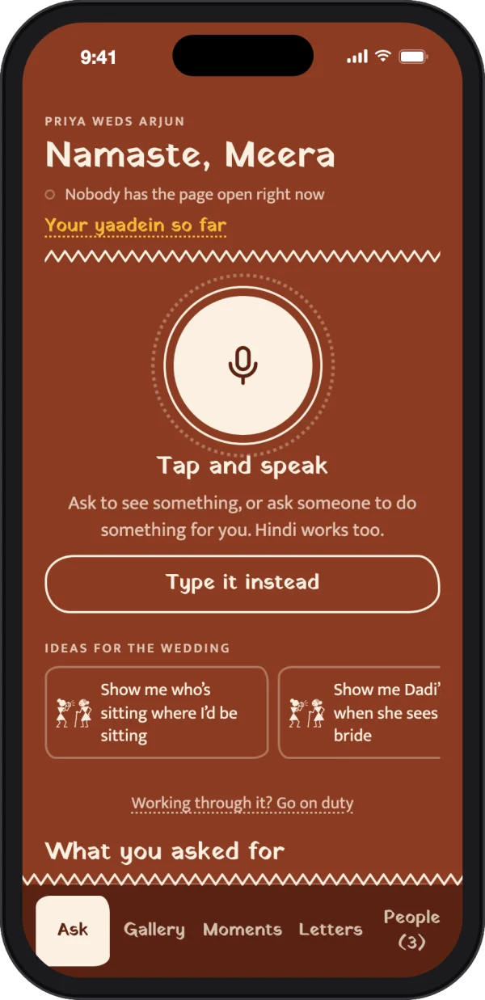
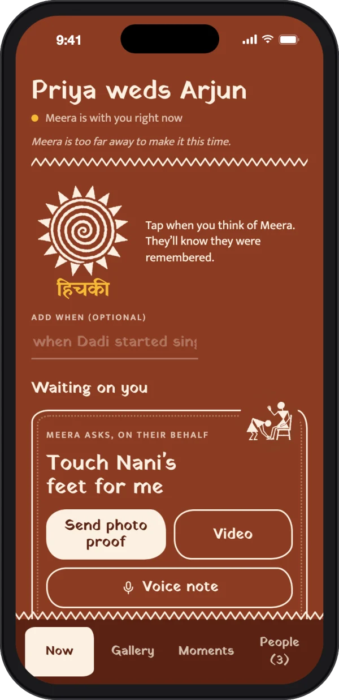
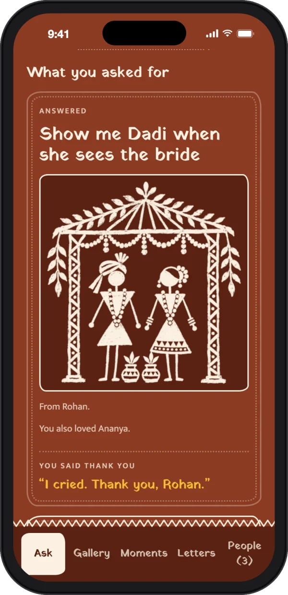
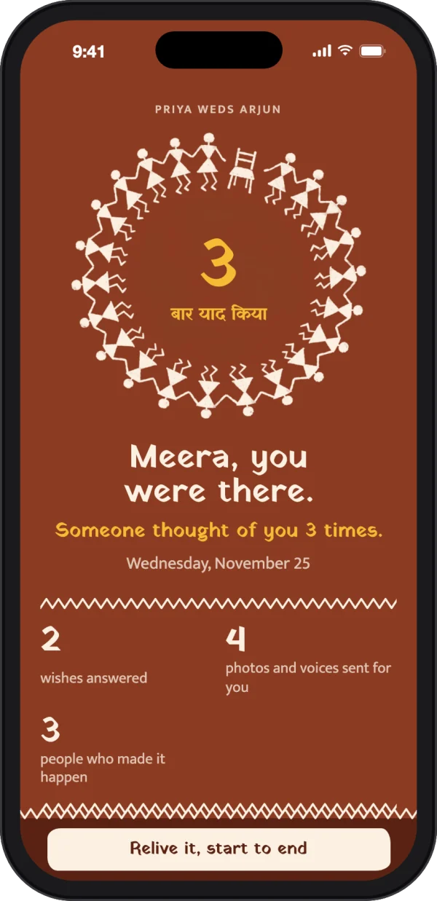
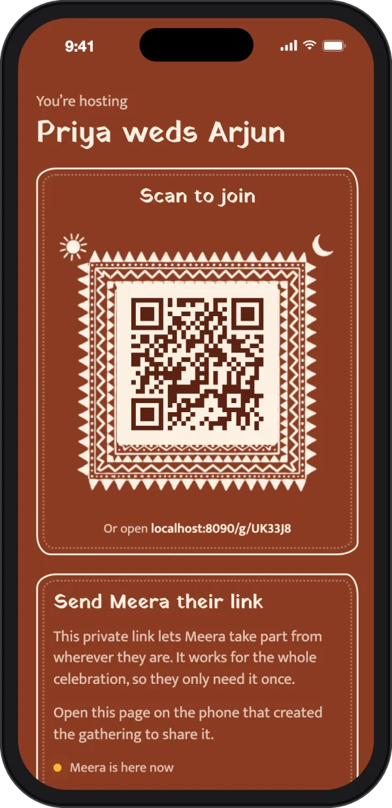

# Hichki

**Try it live: https://cottages-lions-informal-suffered.trycloudflare.com** (the earlier tunnel link closed, so this is a new one)

**Kisi ne yaad kiya.** Someone remembered you.

### We've all been there: somewhere we badly wanted to be, and couldn't, for one reason or another.

Every wedding and every Diwali has an empty chair: the sister whose visa didn't come through, the son on a night shift abroad, the grandfather too unwell to travel. A video call lets them watch, but not take part. Hichki gives the person who couldn't come a real place at the gathering, using just their voice.

<p align="center">
  
  
  
  
</p>

## How it works

The host creates a gathering and gets a QR code for the table and a private link for the person who couldn't come. Guests scan and type a name: no app, no account. The person far away opens their link and talks, in Hindi, English or any Indian language.

- **Be my eyes.** "Show me Dadi when she sees the bride." Every phone in the room gets the request; the best photo wins points and a thank-you.
- **Meri taraf se** (on my behalf). "Touch Nani's feet for me." Someone does it and sends proof.
- **Hichki** (hiccup). One tap tells them they were just thought of. It goes both ways.
- **Jab kholna** (open when). Voice letters that unlock when the moment comes: "Open when the cake is cut."
- **Dadi ki kahani.** An elder tells a story in her own language; family anywhere can hear it and read it translated.
- **Duty pe** (on duty). For the nurse, soldier or rider working through the holiday: nothing buzzes during the shift, and everything is waiting after.
- **Yaadein** (memories). When it's over, everything that happened lives on one page to replay and share.

Requests can be scheduled across a multi-day wedding, feature names follow the room's language and script (हिचकी, ಹಿಚ್ಕಿ, ஹிச்கி), and hosts can require Google or phone sign-in.

<p align="center">
  
</p>

## Made with

- **[Sarvam AI](https://www.sarvam.ai)** turns spoken requests into cards and transcribes and translates stories. A whole wedding weekend costs about ₹13.
- **[Flagsmith](https://www.flagsmith.com)** switches features on and off live, and holds the per-occasion ideas.
- **[NudgeBee](https://nudgebee.com)** watches the server; it found a deliberately broken upload's root cause in about eight minutes.
- **[Clerk](https://clerk.com)** handles optional sign-in for verified gatherings.

Photos, voices and stories stay on our own server. Recordings go to Sarvam only to be transcribed and translated.

## Run it

```bash
npm install
npm run dev
```

Then open http://localhost:5173. Keys, Kubernetes and phone access are in [docs/setup.md](docs/setup.md); design in [ARCHITECTURE.md](ARCHITECTURE.md); routes in [docs/api.md](docs/api.md).

## About

Built in one day at [Festive Hacks](https://www.wemakedevs.org/hackathons/festivehacks), Bengaluru, 25 November 2026, with Claude writing much of the code alongside a person who chose every feature, tested it on real phones and reviewed what shipped. The Warli-style paintings were made with an AI image model for this project. Feature names in Hindi, English and Kannada were checked by hand; other languages should be checked by native speakers.

Screenshots show a demo gathering, with the app's own paintings standing in for photos.
